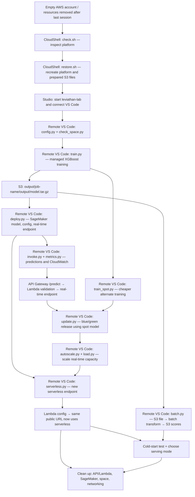

# AWS SageMaker — Part 2: Training and Serving from Code

## Objective

The previous session established a private SageMaker development environment and prepared a return-prediction dataset. **Today's progression is from “we have clean training files in S3” to “we can train, deploy, operate, compare, and retire a model using repeatable code.”**

**Scenario:** An online store wants a prediction of whether an order will be returned. The input is the prepared version of `returns.csv`: 12,000 synthetic orders, split into training (8,400 rows), validation (1,800 rows), and held-back batch data (1,800 rows). The 18 numerical features must appear in exactly the same order at training and inference time. The model predicts a probability of return.

**One useful opening question:** “We already have the data in S3. If a website needs a prediction now, an analyst needs 1,800 predictions tonight, and the model gets retrained next week, should all three cases use the same kind of AWS resource?”

**Operating rule:** The notebook is a **copy/paste guide to different destinations**, not a notebook to execute with **Run all**. Watch the destination above each code cell: **CloudShell**, **remote VS Code terminal**, **Lambda code editor**, **AWS console**, or **local laptop terminal**. The Python scripts run **on the remote SageMaker space** when launched from VS Code's remote terminal.

## One-page project flow

**What connects everything:** The training job reads **S3 train/validation files** and produces **a model artifact in S3**. Deployment references that artifact; it does not retrain the model. The model and endpoint configuration are definitions; the real-time/serverless endpoints provide the running serving resource. **Batch transform uses the model without a persistent endpoint.** The API Gateway URL is a front door, not the model itself.

### The exact data handoffs

| Artifact/resource | Who creates it | Who consumes it | Why it exists |
|---|---|---|---|
| `raw/returns.csv` | `restore.sh` | Data restoration/preparation | Source records |
| `train/train.csv` | `restore.sh` (recreates the previous session's preparation) | `train.py`, `train_spot.py` | 8,400 labeled, headerless rows |
| `validation/validation.csv` | `restore.sh` | Both training jobs | 1,800 labeled, headerless rows for validation AUC |
| `batch-input/batch.csv` | `restore.sh` | `invoke.py`, `batch.py` | 1,800 unlabeled rows, 18 numerical features |
| `batch-labels/labels.csv` | `restore.sh` | `invoke.py`, `batch.py` | Held-back ground truth for checking predictions |
| `output/<job>/output/model.tar.gz` | Each SageMaker training job | `deploy.py`, `update.py` | Reusable trained model artifact |
| `leviathan-xgb-model` | `deploy.py` | Real-time, serverless, and batch configurations/jobs | SageMaker model definition pointing to the original artifact |
| `leviathan-xgb-rt` | `deploy.py` | Direct SDK calls; Lambda initially | Continuously running real-time endpoint |
| `leviathan-xgb-sl` | `serverless.py` | Lambda after section 4.1 | On-demand serverless endpoint |
| `batch-output/batch.csv.out` | `batch.py`'s batch transform job | `batch.py`'s evaluation step | File of prediction scores, aligned with input rows |

## Detailed section list — in notebook order

### 0. Preface / recap — What changes today?

- **Reconnect the previous session:** private VPC; execution role; VPC-only SageMaker domain/space; remote VS Code; S3 train, validation, batch-input and batch-labels files; 18 ordered features; no `refund_amount` leakage.
- **Today's three hats:** *platform engineer* (restore infrastructure), *ML engineer* (launch training and deployments), then *ML platform/operator* (validation, logs, releases, autoscaling, cost, cleanup).
- **Clarify the distinction:** writing `train.py` or `deploy.py` does not mean the training/inference machine is the Studio space. The space **submits AWS jobs**; SageMaker provisions separate managed compute.
- **Outcome:** We can locate this session in the complete lifecycle and distinguish project code, AWS resources, and S3 artifacts.

### 1. Building the platform from nothing

**Notebook:** §1, §1.1–1.4.

**1.1 — Inspect before changing anything (CloudShell)**

- `check.sh` checks the VPC, gateways, NAT, VPC endpoints, security groups, IAM role, S3 bucket/files, domain, profile and space.
- Teach the statuses **OK / MISSING / NOT-YET**. This is an inspection script, not a provisioning script.
- **Ask:** “Why is a read-only check safer than immediately rerunning 30 AWS console steps?”

**1.2 — Rebuild reproducibly (CloudShell)**

- `restore.sh` brings back the `leviathan` private environment, including **two private subnets**, route tables, NAT, **one S3 gateway endpoint**, **six interface endpoints**, security groups and IAM role.
- It also recreates the bucket, raw dataset and four prepared files, then the VPC-only `leviathan-domain`, user `instructor`, and `leviathan-lab` space.
- The script checks for named resources before creating them, so rerunning it can resume an interrupted restoration. The space's configured idle timeout is **180 minutes** in this notebook.
- **Distinction:** The private subnet's network paths make services *reachable*; the IAM role makes actions *permitted*.

**1.3 — Verify provisioning (CloudShell)**

- Rerun `check.sh` and confirm everything is **OK** before starting the space.

**1.4 — Reconnect to the private workspace (Studio → laptop VS Code → remote terminal)**

- Start `leviathan-lab`; use **Open in VS Code**. Create `/home/sagemaker-user/leviathan` on the new space.
- Create `config.py` (shared bucket and region) and `check_space.py` (STS identity, SageMaker API, S3, private DNS and internet/NAT checks).
- **Critical distinction:** The VS Code window is local; the files, Python interpreter and terminal are on SageMaker.
- **Checkpoint:** Can We explain why `check.sh` and `check_space.py` perform different tests?
- **Transition:** “The platform is reachable and authorized. What do we ask SageMaker to do with our training CSVs?”

### 2. A training job from code

**Notebook:** §2, §2.1, §2.2 and Checkpoint 2.1.

**Base training (`train.py`, remote VS Code)**

- Introduce SageMaker Python SDK v3: `ModelTrainer`, `Compute`, `InputData` channels, `OutputDataConfig`, and the built-in **XGBoost 1.7-1** container.
- Inputs: `train/` and `validation/` in S3. Compute: **`ml.m5.large`**, one instance. Objective: **`binary:logistic`**. Evaluation: **AUC**.
- Execution: `python train.py` submits a *managed training job*; the training instance is not the Studio space.
- Output: a job status, metrics, billable time, and an S3 URI ending in **`model.tar.gz`**.
- **Ask:** “Where does the trained model survive after SageMaker shuts down the training machine?”

**2.1 — Read results, rather than trusting 'Completed'**

- In the SageMaker console, inspect the job's status history, **CloudWatch training logs**, training image, channels, metric charts and output S3 URI.
- Check the expected dimensions: **8,400 train rows × 18 features**; **1,800 validation rows**.
- The notebook's example reports **train AUC ≈ 0.850** and **validation AUC ≈ 0.708**. Discuss generalization rather than treating training AUC as the final score.
- Highlight the failure case in the notebook: an IAM role that can list a file but cannot `s3:GetObject` it can waste billed compute before failing.

**2.2 — Lower-cost training (`train_spot.py`)**

- Retrain with **managed spot training**, maximum wait duration, S3 checkpoint prefix and project tags.
- Trade-off: lower cost but capacity can be interrupted or delayed. In the demonstrated run, the notebook reports **61% savings**; not a guaranteed discount.
- The output is **a second `model.tar.gz`**, used later by `update.py`.

**Checkpoint 2.1:** Copy `train.py` to `train_deep.py`, change `max_depth` from **4 to 8**, and compare train versus validation AUC to reason about overfitting.

**Transition:** “Training has produced an artifact, not an application. How do requests reach that artifact?”

### 3. A real-time endpoint — From model artifact to a usable API

**Notebook:** §3, §3.1–3.6.

**3.0 — Deployment (`deploy.py`, remote VS Code)**

- Stress the **three different SageMaker objects** created in order: **Model → Endpoint configuration → Endpoint**.
- `leviathan-xgb-model` references the XGBoost image + model artifact; `leviathan-xgb-rt-config` specifies one `ml.m5.large`; `leviathan-xgb-rt` starts serving.
- The endpoint consumes hourly capacity while deployed; the model and configuration definitions do not rent a machine by themselves.
- **Ask:** “If a training job is already Completed, why is the deployment still taking time?”

**3.1 — Direct requests (`invoke.py`, remote VS Code)**

- `boto3.client('sagemaker-runtime').invoke_endpoint(...)` sends **one CSV row of 18 features, without the label**, to the endpoint using AWS credentials.
- Read five held-back examples from `batch-input/batch.csv` and match them with `batch-labels/labels.csv`.
- Probe malformed requests: extra feature, missing feature, or text instead of numeric input. Show that some fail loudly while the missing-feature row may be **accepted with shifted columns**.

**3.2 — The silent failure (discussion)**

- A successful HTTP response does **not** imply correct semantic input. The model receives positions, not column names.
- **Ask:** “If the model returns a probability for a 17-column row, how could monitoring detect that it interpreted the wrong values?”

**3.3 — Endpoint monitoring (`metrics.py`, remote VS Code + CloudWatch console)**

- Read `Invocations`, `Invocation4XXErrors`, `Invocation5XXErrors`, `ModelLatency` and `OverheadLatency`.
- Contrast **container latency**, **SageMaker overhead**, and **caller-observed network latency**.
- A misaligned row that succeeds is not counted as an error; reused endpoint names can also complicate historical metric windows.

**3.4 — A public-facing validated route (AWS console + local laptop terminal)**

- Introduce: **laptop/browser → API Gateway `POST /predict` → `leviathan-predict` Lambda → SageMaker Runtime → `leviathan-xgb-rt`**.
- Lambda accepts an order as JSON with named fields, verifies missing/unknown values, constructs the **same 18 features in the expected order**, calls the endpoint and returns `p_return`.
- Its execution role needs the specific `sagemaker:InvokeEndpoint` permission; API Gateway supplies the public HTTPS URL.
- Verify with `curl` from the **laptop's own terminal**: valid order **200**, missing `price` **400**, unknown category **400**. Initially, a missing Lambda invoke permission can appear to the caller as **500**; the Lambda log explains why.
- Configure API Gateway throttling in the example (**rate 5/s**, **burst 10**); illustrate **429** and why throttling is best-effort, **not authentication**.
- **Checkpoint:** Which part is publicly callable? Which part signs the AWS request? Which part prevents a shifted column?

**3.5 — Release a new model (`update.py`, remote VS Code)**

- Input: the **spot-trained** `model.tar.gz` from §2.2. Create a new SageMaker model + endpoint configuration, then update the existing real-time endpoint.
- Explain **blue/green**, an **ALL_AT_ONCE** traffic switch, a CloudWatch **5XX rollback alarm**, and a background stream of test requests.
- Look beyond `InService`: inspect **which endpoint configuration is actually active** and any `FailureReason` after failed releases.
- **Source check:** The narrative describes a 120-second baking period, but `update.py` currently sets `wait_interval_in_seconds=0`; the teaching explanation and code should be reconciled.

**3.6 — Autoscaling (`autoscale.py`, `load.py`, remote VS Code)**

- Application Auto Scaling registers `leviathan-xgb-rt/variant/AllTraffic` with **min 1, max 2 instances**, aiming at **300 invocations/minute/instance**.
- `load.py` generates steady traffic; inspect *desired* versus *current* instances and explain why CloudWatch alarms + instance startup lead to **minutes**, not immediate scaling.
- **Note:** The supplied `autoscale.py` code cell contains a stray standalone `œ` that must be removed before executing it.
- **Transition:** “What if keeping a real-time machine running all day is too expensive for our traffic pattern?”

### 4. A serverless endpoint

**Notebook:** §4 and §4.1.

**4.0 — Deploy (`serverless.py`, remote VS Code)**

- Reuse `leviathan-xgb-model` but create `leviathan-xgb-sl-config` with **1024 MB** and **MaxConcurrency 20**, then deploy `leviathan-xgb-sl`.
- Unlike provisioned real-time inference, serverless does not hold the same dedicated instance around for continuous requests; its trade-off is **cold-start latency**.
- Show why the notebook switches to **boto3 for endpoint configuration creation**: the noted installed SDK version sends an incorrect key (`MemorySizeInMb` instead of `MemorySizeInMB`). This is a documented workaround for this notebook's environment, not a universal rule.

**4.1 — Repoint the same public URL (Lambda console + local laptop)**

- Change Lambda's `ENDPOINT_NAME` to **`leviathan-xgb-sl`**; expand its invoke policy to allow the serverless endpoint.
- Raise Lambda timeout from **3 seconds to 30 seconds** so cold starts have time to finish.
- Test the **same** API Gateway URL. Callers do not have to know the backend changed.
- **Ask:** “Why did we change Lambda's permissions and timeout even though its JSON input/output contract did not change?”
- **Transition:** “For the orders nobody needs immediately, do we need an HTTP endpoint at all?”

### 5. Batch transform, cold starts and choosing the serving mode

**Notebook:** §5, §5.1 and Checkpoint 5.1.

**Batch transform (`batch.py`, remote VS Code)**

- Create a `TransformJob` using `leviathan-xgb-model`. It reads **`batch-input/batch.csv`**, runs temporary compute, and writes **`batch-output/batch.csv.out`**.
- `split_type='Line'` supplies individual rows and `assemble_with='Line'` keeps predictions line-separated and ordered.
- Read **1,800 predicted probabilities**, pair them with **`batch-labels/labels.csv`**, calculate held-back ROC AUC. The notebook's demonstration reports **0.726**.
- **Crucial distinction:** This does not call either endpoint. It starts a separate job and stops after scoring the file.

**5.1 — Measure a serverless cold start (local laptop terminal)**

- After the serverless endpoint has been idle, send the same valid request **four times** through the unchanged public URL.
- The notebook's example shows **~12.3 s** for the first request and **~0.7–0.8 s** for later warm requests. These are observed examples, not latency guarantees.
- Compare serving choices by *traffic pattern and acceptable waiting time*, not by which AWS option is newest.

| Serving approach | What is running | Payment model (conceptual) | Fit in this session |
|---|---|---|---|
| Real-time endpoint | Provisioned serving instance(s) | Pay while instance(s) remain deployed | Fast, steady or latency-sensitive orders |
| Serverless endpoint | On-demand serving capacity | Pay for processing/requests rather than continuously provisioned instance hours | Infrequent or bursty interactive requests tolerant of cold starts |
| Batch transform | Temporary transform job | Pay while batch compute runs | Whole file scored without a waiting user |

**Checkpoint 5.1:** Choose a serving method for (a) a return-risk badge on every product page, (b) a nightly warehouse report, and (c) an internal support tool opened about twenty times daily. Require one sentence of reasoning per choice; (c) admits more than one defensible answer.

### 6. Tearing it all down

**Notebook:** §6.

- **Public front door first (AWS console):** delete `leviathan-api`, `leviathan-predict`, its Lambda execution role, remaining generated IAM policy, and `/aws/lambda/leviathan-predict` log group.
- **SageMaker serving next (`cleanup.py` from remote VS Code):** remove Application Auto Scaling target/policies, the rollback alarm, **both endpoints**, the endpoint configurations and SageMaker model definitions.
- **Workspace (Studio):** close remote VS Code and **stop** `leviathan-lab`. Closing a browser or editor window alone does not stop compute.
- **Network (VPC console):** remove **six interface endpoints** and the **regional NAT gateway**; check for Elastic IP leftovers. The S3 gateway endpoint can remain if the VPC is retained.
- Explain what can remain with little/no active cost: stopped space's disk, domain/profile, VPC, IAM role, tiny S3 objects, and the history of completed training/batch jobs.
- **Checkpoint:** “If the endpoints are deleted, what else could keep billing? If the Studio space is stopped, what is *not* automatically deleted?”

### 7. session summary

**Notebook:** §7.

- **Reproducible platform:** `check.sh` observes, `restore.sh` provisions, `check_space.py` verifies from inside.
- **Training:** temporary managed compute + S3 inputs → S3 model artifact; spot is a cost/availability trade-off.
- **Serving:** one model artifact can be delivered through a real-time endpoint, serverless endpoint, or batch transform; these are different operational choices.
- **Operating a service:** schema validation, IAM, CloudWatch, API Gateway/Lambda, release guardrails, autoscaling and cleanup are not incidental details.
- **Quiet failures to remember:** IAM read denied after training starts; a missing feature silently shifts columns; a missing Lambda permission or cold-start timeout appears as HTTP 500; an endpoint can be `InService` after an unsuccessful update; and an SDK integration may require a boto3 workaround.

### 8. References and further reading

**Notebook:** §8.

- Point We to the notebook's official AWS references for **managed training**, **SageMaker Python SDK**, **built-in XGBoost**, **managed spot training**, **deployment guardrails**, **autoscaling**, **CloudWatch**, **real-time/serverless inference**, **batch transform** and **NAT**.
- **Pricing caveat:** Dollar amounts and measured timings in the notebook are example observations; region, account settings and AWS pricing may change.

## Where am I? — Destination map

| Stage | Where you work | Main things created or inspected |
|---|---|---|
| §1.1–1.3 | **AWS CloudShell in browser** | `check.sh`, `restore.sh`, VPC/IAM/S3/Studio infrastructure |
| §1.4–3.3 | **Remote VS Code terminal on SageMaker space** | `config.py`, checks, training, deployment, direct invocation and metrics |
| §3.4 | **Lambda editor + API Gateway/IAM in browser; local laptop terminal for curl** | Public JSON API, Lambda invoke role, throttling, HTTP results |
| §3.5–4.0 | **Remote VS Code terminal, SageMaker console for observation** | Blue/green update, autoscaling, load, serverless deployment |
| §4.1 | **Lambda console + laptop terminal** | Switch existing public route to serverless |
| §5 | **Remote VS Code for batch; laptop terminal for cold start** | Batch scores, AUC and end-to-end latency |
| §6 | **AWS console + remote VS Code cleanup script** | Delete public API, serving resources and billable infrastructure |

## Suggested pacing and stopping points

| Phase | Notebook sections | Suggested discussion/demo time* |
|---|---|---|
| Recap + platform restore and verification | Preface, §1 | 20–35 min |
| Managed training, result reading, spot experiment | §2 | 20–30 min |
| Real-time deployment, malformed inputs, metrics | §3–3.3 | 20–30 min |
| Lambda/API Gateway, API testing, throttling | §3.4 | 20–30 min |
| Blue/green and autoscaling demonstrations | §3.5–3.6 | 20–30 min |
| Serverless and public route switch | §4 | 10–20 min |
| Batch, cold start, serving trade-offs | §5 | 15–25 min |
| Teardown and recap | §6–8 | 15–20 min |

*These are **teaching estimates**, not guaranteed elapsed times. AWS provisioning, training, endpoint creation, blue/green releases, and load-test/autoscaling delays can lengthen the session substantially. A natural split is **after §3.4**: the second meeting then begins with model releases and different serving options. If splitting, explicitly decide which expensive resources will remain running between sessions.*

## Four questions to repeat throughout the lesson

1. **Where is this command executing?** CloudShell, local laptop, remote SageMaker space, Lambda runtime, or a managed SageMaker job?
2. **What is the resource actually doing?** Storing data, authorizing access, training a model, hosting a model, validating requests, monitoring, or routing traffic?
3. **What is handed to the next step?** An S3 URI, a model resource, an endpoint name, a JSON request, a score file, or a metric?
4. **What is the cost and lifecycle?** Is this one-time compute, continuously provisioned compute, request-billed serving, or a resource that must be manually deleted?

## Scope boundary

**Completed in this session:** restore and verify the private platform; run managed XGBoost training (on-demand and spot); inspect training logs and AUC; deploy, invoke and monitor a real-time endpoint; create a public validated JSON route; demonstrate throttling, blue/green updates and autoscaling; deploy serverless inference and measure cold starts; run batch transform and calculate held-back AUC; clean up resources.

**Not established by this session:** an authenticated production API, a fully shared single-source feature transformation module across training and Lambda, automated CI/CD, guaranteed cold-start or autoscaling response times, or a permanently running production system.

## Notebook consistency checks before presenting

These are **differences within the supplied notebook**, not changes silently made to its code:

- **Region label:** the preface calls **“N. Virginia (us-west-2)”**, but `us-west-2` is **US West (Oregon)**. The restoration script and model examples explicitly use `us-west-2`; keep the console region consistent with the scripts.
- **Blue/green waiting time:** prose says `wait_interval_in_seconds=120`; the `update.py` cell uses **`0`**. Align the narrative and implementation before describing a two-minute bake.
- **Autoscaling code typo:** the `autoscale.py` code cell has a stray standalone **`œ`**, which will raise an error if copied as Python. Remove that character.
- **Notebook agenda:** it lists a **“What's next”** section, but the uploaded notebook ends with §8 **References and further reading**. Update the agenda or add that section if desired.

