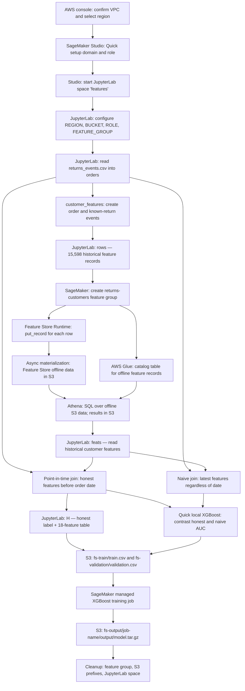
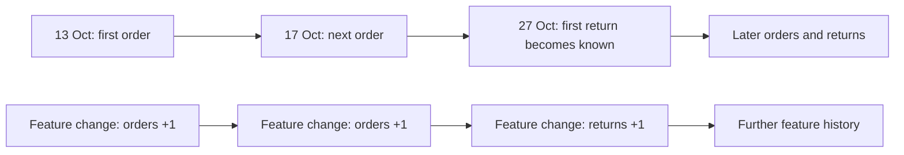

# AWS SageMaker Feature Store — Part 1: From Orders to Training Features

## Objective

This session moves from **raw order records** to **a reusable, time-aware customer-feature history** and finally to **a SageMaker-trained return-prediction model**.

The key progression is:

**Raw orders → customer events → historical feature rows → SageMaker Feature Store → S3 offline history → Athena query → point-in-time training table → XGBoost training job → S3 model artifact.**

**Scenario:** An online shop wants to predict **at checkout** whether an order will be returned. The source file contains **12,000 synthetic orders from 1,440 customers**, spanning **October 2025–September 2026**. A returned parcel is treated as **known 14 days after its order**. This time delay is fundamental: features used to predict an order cannot reveal the result of that order or any future order.

**One useful opening question:** “If customer C-00001 places an order on 10 August, should the model use that customer's return rate from 10 August, from 14 September, or from the latest record **before** 10 August?”

**Operating rule:** Unlike the previous SageMaker project (which used CloudShell and remote VS Code), this notebook uses **AWS console/Studio for initial setup**, then **Python code running in a SageMaker JupyterLab space**. Some code-formatted cells are **copyable reference text or illustrative examples, not executable Python**. The saved outputs are demonstrations; actual AWS IDs, latency and results can differ.

## One-page project flow

**What connects everything:** `orders` and `rows` are **in-memory pandas tables inside JupyterLab**. The feature group is an **AWS-managed schema/resource**. `put_record` sends feature events to Feature Store, which later materializes them in **S3 offline storage**. **Glue describes the stored data**; **Athena queries it**. The notebook brings the results back into pandas to build an honest training table, uploads **training/validation CSVs to S3**, and asks **separate SageMaker-managed training compute** to create `model.tar.gz`. **No inference endpoint is created in this class.**

## The essential timeline: why a point-in-time join matters

A feature row does not represent the answer to the current order. It represents what was known about the customer **at a particular event time**.

In the notebook's **10 August 2026** illustration for customer `C-00001`:

| Feature event | `orders_so_far` | `returns_so_far` | Usable for the 10 August prediction? |
|---|---:|---:|---|
| **27 June 2026** | 11 | 9 | **Yes:** newest earlier record |
| **10 August 2026** | 12 | 9 | **No:** already counts the order being predicted |
| **24 August 2026** | 12 | 10 | **No:** knows the order was returned |
| **14 September 2026** | 14 | 11 | **No:** includes even more future information |

The correct relationship is **feature `event_time` strictly earlier than `order_date`**. The notebook implements this with `pd.merge_asof(..., by="customer_id", allow_exact_matches=False)`. A naive join that takes each customer's latest feature row instead causes **future-information leakage**, even if code executes without errors.

### The exact data and resource handoffs

| Artifact / resource | Produced by | Used by | Purpose |
|---|---|---|---|
| Course-hosted `returns_events.csv` | Supplied dataset | `pd.read_csv(ORDERS_URL)` | Raw 12,000 labeled orders |
| `orders` (pandas DataFrame) | Section 4 data-loading cell | `customer_features`, `honest`, `naive`, `model_table` | Raw records in JupyterLab memory |
| `rows` (pandas DataFrame) | `customer_features(orders)` | `put_record` | 15,598 event-timestamped customer feature rows |
| `returns-customers` feature group | `sm.create_feature_group` | Feature Store Runtime; group metadata/Glue | Defines six typed features, record key, event time and offline storage |
| Feature Store offline S3 files under `feature-store/` | Asynchronous Feature Store materialization | Athena | Historical customer feature records |
| Glue catalog table `returns_customers_<suffix>` | Feature Store setup | Athena | SQL schema and metadata for the offline data |
| S3 `athena/<query-id>.csv` | Athena queries | `query()` → pandas | SQL query results |
| `feats` (pandas DataFrame) | Athena `SELECT` in section 8 | `pd.merge_asof`, naive merge | Historical features for point-in-time joins |
| `honest` and `naive` | Section 8 joins | `model_table`, model evaluation | Correct-vs-leaky order-to-feature associations |
| `H` and `N` | `model_table` | Local XGBoost; `H` also exported to S3 | Numeric model tables: one label + 18 inputs |
| `fs-train/train.csv` | `s3.put_object` from `H[train]` | SageMaker training `train` channel | 9,014 labeled records |
| `fs-validation/validation.csv` | `s3.put_object` from `H[check]` | SageMaker training `validation` channel | 2,986 labeled records |
| `fs-output/<job>/output/model.tar.gz` | SageMaker managed training | Subsequent serving class | Reusable trained XGBoost model artifact |

**Be precise about storage:** The feature group is *not* the training CSV, Glue is *not* the feature data, and Athena is *not* the place where the history is stored. The **history lives in S3**; the catalog makes it queryable; the query results are materialized separately.

## Detailed section list — in notebook order

### 0. Preface — Why store features rather than recompute them everywhere?

**Notebook:** Preface and agenda.

- An order row describes the current transaction. A **customer feature** summarizes information across earlier transactions.
- Two problems motivate Feature Store: training and inference may calculate features differently, and retrospective training may accidentally use later information.
- The class follows **the offline/training path**. It introduces the online/live path conceptually but does not implement it.
- **Checkpoint:** Explain the difference between an order-level column (`price`) and a history-derived customer feature (`return_rate`).

### 1. What a feature store is

**Notebook:** §1.1–1.2.

- **Feature:** a model input computed or selected from source data.
- **Feature group:** typed collection of feature records.
- **Record identifier:** `customer_id`, identifying whose history a record belongs to.
- **Event time:** `event_time`, when the recorded state became true.
- **Offline store:** historical records in S3, suitable for bulk analytical reads.
- **Online store:** intended for low-latency access to current feature values; **not configured or used in this notebook**.
- **Ask:** “Why can't we give every historical order the customer's latest return rate?”

### 2. Project context and prediction constraints

**Notebook:** §2.

- Dataset: **12,000 orders, 1,440 customers**, roughly one year of synthetic transactions.
- Target: `returned` (0/1).
- Existing order columns include `category`, `price`, `discount_pct`, `delivery_days`, `payment_method`, `is_gift`, `seller_rating` and `signup_date`.
- **Timing rule:** return outcomes become known **14 days after the original order**.
- **Checkpoint:** Distinguish the date an order happened from the date its outcome became observable.

### 3. Set up AWS and establish the execution environment

**Notebook:** §3.1–3.3.

1. **AWS console:** Confirm a suitable VPC, establish the chosen region, and use SageMaker AI's **single-user Quick setup** for a Studio domain.
2. **Studio browser:** Open the generated user profile; create and run JupyterLab space **`features`**.
3. **JupyterLab:** Upload this notebook and select Python 3 kernel.
4. **Python setup cell:** Create `REGION`, `FEATURE_GROUP`, `ACCOUNT`, `BUCKET` and `ROLE`.

The code expects:

- `REGION = "us-west-2"`
- `FEATURE_GROUP = "returns-customers"`
- `BUCKET = f"sagemaker-{REGION}-{ACCOUNT}"`
- `ROLE = get_execution_role()`

**Crucial distinction:** The **browser** displays Studio; the **JupyterLab space** runs the pandas/Python code; **S3** stores persistent files; later the **training job** runs on separate managed compute.

**Checkpoint:** Can you say which AWS identity authorizes notebook calls, and which compute resource runs the Python kernel?

### 4. From raw orders to event-driven customer history

**Notebook:** §4 and §4.1.

- `orders = pd.read_csv(ORDERS_URL)` reads the synthetic source CSV into memory.
- `customer_features(orders)` creates **two event types**:
  - **Order placed:** `new_orders = 1`, `new_returns = 0`, at `order_date`.
  - **Return known:** `new_orders = 0`, `new_returns = 1`, at `order_date + 14 days`, only if `returned == 1`.
- Combine same-customer/same-day events, sort chronologically and calculate cumulative totals for each customer.
- Calculate four features: `orders_so_far`, `returns_so_far`, `return_rate`, `tenure_days`.
- The smoothed return rate is **`(returns_so_far + 1) / (orders_so_far + 5)`**, rounded to four decimals. Zero orders and returns correspond to 20%.
- Format `event_time` as ISO-8601 text such as `2025-10-13T00:00:00Z`.
- The notebook's saved run yields **15,598 feature records**: more than 12,000 orders because returned orders create additional events (same-day events are combined).

**Output:** In-memory `rows`, containing **six columns**: `customer_id`, `event_time`, and the four calculated features.

**Ask:** “Why does the return counter change on a different day from the order counter?”

### 5. Create the feature group — define *where* those rows will go

**Notebook:** §5.

- `boto3.client("sagemaker")` is the **control-plane** client used to create and describe the group.
- `create_feature_group` defines **six features and types**, `RecordIdentifierFeatureName="customer_id"`, `EventTimeFeatureName="event_time"`, an **offline S3 storage prefix**, and the IAM role.
- Poll `describe_feature_group` until the resource is `Created`.
- SageMaker reports an **offline S3 location** and a **Glue table name**.
- The Feature Store page in Studio shows the group definition; at this point records have **not** yet been ingested.

**Checkpoint:** Explain why creating a feature group is not the same thing as writing feature records to it.

### 6. Ingest the feature rows

**Notebook:** §6.

- Use the **data-plane** client `boto3.client("sagemaker-featurestore-runtime")`.
- `put_record` sends one record as name/value pairs; values are serialized using `ValueAsString`.
- The code retries a first write if the newly created group is temporarily not ready, then uses **eight workers** through `ThreadPoolExecutor` for the full dataset.
- Saved example: **15,598 rows in about 24 seconds**. This describes API ingestion, **not** completion of the S3 offline export.
- The alternative `batch_write_record` example is **commented out** and is not part of the executed path.

**Checkpoint:** What is the difference between an accepted `put_record` call and a feature row becoming queryable in Athena?

### 7. Wait for the offline store; query it with Athena

**Notebook:** §7.

- Feature Store **asynchronously** materializes ingested records in the S3 offline store.
- AWS Glue provides metadata, and **Athena** queries the offline files using SQL.
- The helper `query(sql)` runs an Athena query, polls its status, reads the resulting `athena/<query-id>.csv` from S3 and returns a pandas DataFrame.
- The notebook repeatedly executes `SELECT COUNT(*)` at approximately **30-second intervals**.
- In the recorded run, the count was 0 for several minutes and then reached **15,598 at approximately 346 seconds**. This is an example, not a service-level guarantee.
- Athena also exposes the Feature Store metadata columns `api_invocation_time`, `write_time`, and `is_deleted`.

**Checkpoint:** Why can a successful ingestion API call precede Athena visibility by minutes?

### 8. Build the **honest** training set and expose leakage

**Notebook:** §8.1–8.3 and checkpoint 8.1.

**8.1 — Decide which historical row is valid.** Each order needs the **most recent row for the same customer with `event_time < order_date`**. A row from the same date already counts that day's order in this dataset; later rows may include the return label.

**8.2 — Query all historical features and perform two joins.**

- `feats = query(...)` loads historical feature rows from Athena.
- `pd.merge_asof(..., by="customer_id", allow_exact_matches=False)` produces **`honest`**.
- Taking each customer's last-ever row with `groupby(...).tail(1)` and merging it onto every order produces **`naive`**.
- Saved run: **1,456 orders** have no qualifying prior history. They receive `orders_so_far=0`, `returns_so_far=0`, `return_rate=0.2`, and `tenure_days` derived from signup date in the next step.

**8.3 — Convert both joins into numeric XGBoost tables.**

`model_table` fixes the model's column order:

| Part of model input | Columns | Count |
|---|---|---:|
| Order data | `price`, `discount_pct`, `delivery_days`, `is_gift`, `seller_rating` | 5 |
| Historical customer data | `orders_so_far`, `returns_so_far`, `return_rate`, `tenure_days` | 4 |
| One-hot category | apparel, beauty, books, electronics, home | 5 |
| One-hot payment | card, cod, upi, wallet | 4 |
| **Total features** | | **18** |

The first column is the **label `returned`**, so exported CSVs have **19 columns in total**.

- Split at **1 July 2026**: orders before that date for training, orders on/after it for validation.
- Train **two quick `XGBClassifier` models in the JupyterLab kernel**, one using `H` (honest), one using `N` (naive).
- Saved demonstration AUCs:

| Model | Evaluation features | AUC | Interpretation |
|---|---|---:|---|
| Honest model | Honest | **0.715** | Valid historical-feature evaluation, subject to other input-timing checks |
| Naive model | Naive | **0.833** | Artificially optimistic: evaluation contains later information |
| Naive model | Honest | **0.714** | Performance returns to roughly the honest baseline when future features are removed |

**The essential lesson:** Leakage can produce an impressive score without producing any software error. The joining rule, rather than a metric alone, determines whether the evaluation is meaningful.

**Checkpoint:** For a different customer, confirm manually that `honest.time < honest.order_date` and `orders_so_far` omits the order being scored.

### 9. Export the honest training table; launch managed XGBoost

**Notebook:** §9.

**9.1 — Export to S3**

- `H[train]` → `s3://<BUCKET>/fs-train/train.csv` (**9,014 rows × 19 columns**).
- `H[check]` → `s3://<BUCKET>/fs-validation/validation.csv` (**2,986 rows × 19 columns**).
- CSV format: **no header, label first, 18 ordered numeric features next**.
- **Only `H` is exported.** `N` is used for the leakage demonstration, not the final SageMaker job.

**9.2 — Managed training**

- `sm.create_training_job(...)` submits a **separate SageMaker training job**, not a training run within the JupyterLab machine.
- Built-in **XGBoost 1.7-1** container for `us-west-2`.
- Training algorithm: `binary:logistic`; evaluation: `auc`; `num_round=200`, `eta=0.1`, `max_depth=4`.
- Instance: **one `ml.m5.large`**; training job consumes S3 `train` and `validation` channels.
- Poll with `describe_training_job` until training ends; inspect status, reported validation AUC and S3 model location.
- Saved run: **validation AUC ≈ 0.721**; model artifact at **`fs-output/<job-name>/output/model.tar.gz`**.

**Checkpoint:** Why can the SageMaker training job finish and its machine terminate without losing the trained model?

**Transition:** The result is a **model artifact in S3**, not a deployed API. A later class can create a serving resource that loads it.

### 10. Clean up deliberately

**Notebook:** §10.

- `delete_feature_group` removes `returns-customers`.
- The notebook's cleanup code also deletes **every object** under these S3 prefixes: `feature-store/`, `athena/`, `fs-train/`, `fs-validation/`, `fs-output/`.
- Studio: stop the JupyterLab space **`features`**. Closing its browser tab alone does not stop the space.
- The notebook intentionally leaves the Studio domain and role in place; it also says a Glue catalog entry may remain.
- **Warning:** Deleting entire bucket prefixes can delete unrelated work if the bucket/prefixes are shared. Verify ownership before running cleanup.

### 11. Summary; 12. References

**Notebook:** §11–12.

- Raw orders became **historical, time-stamped customer features**.
- A SageMaker Feature Store group accepted these records, then materialized them in **S3 offline storage**.
- Glue + Athena made the history queryable.
- The honest point-in-time join prevented **future customer history** from being attached to earlier orders.
- Two local models illustrated how an incorrect join inflates AUC.
- The honest table became headerless S3 CSVs, then a **managed training job** and **S3 model artifact**.
- The **online store, endpoint deployment, and real-time inference** belong to the later session, not this one.

## “Where am I?” — destination and execution map

| Notebook stage | Where you act / code executes | What is created or inspected |
|---|---|---|
| §3.1 | **AWS console** | Default VPC, SageMaker domain, generated IAM role/bucket assumptions |
| §3.2–3.3 | **Studio browser → JupyterLab** | Running `features` space, notebook and Python kernel |
| §4 | **JupyterLab Python kernel** | `orders` and `rows` pandas tables |
| §5 | **JupyterLab calls SageMaker control-plane APIs** | Feature-group definition and offline destination |
| §6 | **JupyterLab calls Feature Store Runtime APIs** | Ingested feature records |
| §7 | **Feature Store → S3; Glue + Athena; JupyterLab polling** | Offline files, Glue table and S3 query results |
| §8 | **JupyterLab pandas/scikit-learn/XGBoost** | `feats`, `honest`, `naive`, `H`, `N`, model AUC comparisons |
| §9 export | **JupyterLab calls S3 APIs** | `fs-train/` and `fs-validation/` CSVs |
| §9 training | **JupyterLab submits job; SageMaker managed training compute runs it** | Training metrics and `model.tar.gz` |
| §10 | **JupyterLab + Studio browser** | Feature group and files removed; space stopped |

**A four-question navigation habit** for each stage:

1. **Where is the code actually executing?** Browser, JupyterLab kernel, SageMaker-managed training instance, or Athena?
2. **What holds the data at this instant?** A pandas variable, Feature Store group, S3 object, Glue table metadata, or training container?
3. **What moves to the next stage?** An API call, a feature record, a SQL result, an S3 prefix, or a model artifact URI?
4. **Which date does this value describe?** Order time, return-known time, feature event time, ingestion time, or training execution time?

## Suggested pacing and stopping points

| Phase | Notebook sections | Suggested demonstration/discussion time* |
|---|---|---|
| Motivation, scenario, AWS setup | Preface, §§1–3 | 20–30 min |
| Build customer event history | §4 | 20–25 min |
| Create feature group and ingest | §§5–6 | 15–25 min |
| Offline store, Glue and Athena | §7 | 15–25 min, plus asynchronous export delay |
| Point-in-time vs naive join; AUC experiment | §8 | 30–40 min |
| Managed training and model artifact | §9 | 20–30 min, plus job-provisioning delay |
| Cleanup and recap | §§10–12 | 10–15 min |

*Illustrative facilitation times, not guaranteed AWS task durations. A natural split is **after §7**: the first meeting constructs historical features, and the next establishes point-in-time correctness and trains.*

## Scope boundary — what this notebook actually establishes

**Implemented:** Quick-setup Studio/JupyterLab workspace; loading synthetic orders; creation of order and delayed-return feature events; offline Feature Store group; feature ingestion; historical data materialization in S3; Athena querying; point-in-time vs naive comparison; local XGBoost AUC demonstration; honest CSV export; managed SageMaker training job; artifact output; cleanup.

**Not implemented:** A live online feature lookup, a SageMaker model resource, real-time endpoint, public prediction API, automated feature ingestion for future incoming orders, CI/CD, comprehensive historical availability validation of every order feature, or production-grade end-to-end feature parity. Those are not outcomes to claim from this class.

## Notebook consistency and teaching checks

These observations are grounded in the supplied notebook; they **do not silently modify its implementation**.

1. **AWS region mismatch.** The setup prose labels the chosen region **“United States (N. Virginia)”** but the code uses **`us-west-2`**, which is **US West (Oregon)**. Choose one region and keep the console, SDK, ECR image and S3 names consistent. The code currently assumes `us-west-2`.
2. **`delivery_days` may leak future information.** `model_table` includes `delivery_days` among the five order inputs, yet the use case is a prediction **at checkout**. If this column is the *actual time taken to deliver*, it will not be available at checkout and is another form of future-information leakage even with an honest customer-history join. It would be valid only if this represents a checkout-time known/predicted delivery duration. **The notebook does not establish which interpretation applies.** Verify it before presenting the AUC as deployable checkout performance.
3. **Offline-only code path.** The group creation cell specifies `OfflineStoreConfig` and does **not** specify `OnlineStoreConfig`. The next class cannot be said to read an online store already configured by this notebook. The current class also deletes the feature group during teardown.
4. **First-history counts need careful wording.** The result is **1,456 orders with no feature row strictly before the order date**, not necessarily 1,456 distinct first-time customers: the dataset has 1,440 customers, and strict day-level matching can exclude multiple same-day orders.
5. **Two `customer_features` definitions appear.** The function is defined and invoked in the first cell; a later code cell defines it again in a more verbose form but does **not** reassign `rows`. If the later cell is executed, the function name changes but the already-built `rows` table remains unchanged until explicitly regenerated.
6. **Several `code` cells are actually reference text.** Examples include raw tabular examples, service names, region strings, the formula and sample customer IDs. Do **not** use `Run All`; run only the intentional Python cells as instructed.
7. **Do not overstate timing or pricing.** The values **15,598 rows**, **24 seconds**, **346 seconds**, **0.715/0.833/0.714**, **0.721**, and **180 seconds** are saved observations from the notebook, not guarantees for another AWS account or run.
8. **Broad S3 deletion.** The teardown loops over shared-looking prefixes; it is not limited to the specific objects or job created in this run. Check for unrelated content before executing.
9. **Point-in-time correctness is necessary, not sufficient.** The historical join avoids future **customer-history** values, but a full checkout-time audit must also verify all direct order columns and the precise time each column was known. `tenure_days` additionally reflects its last feature event, so it may be stale between events unless recomputed or refreshed.

## The one sentence to keep repeating

**A trustworthy training example contains only the information that was available when the prediction would actually have been made.** Feature Store keeps the history that makes this possible; the **point-in-time join** chooses the correct slice of that history; **SageMaker training** consumes the resulting frozen CSV files.
