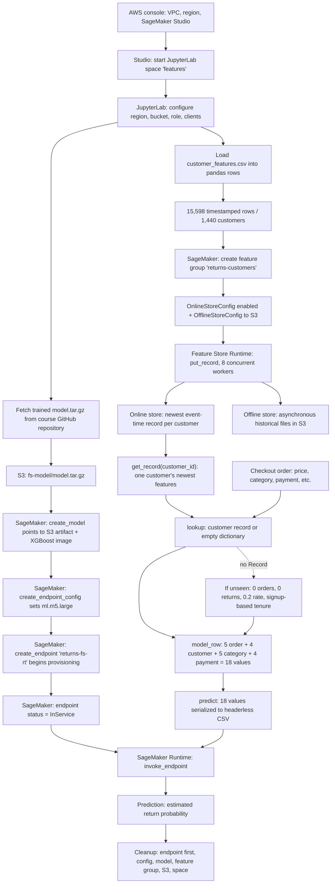
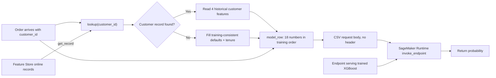
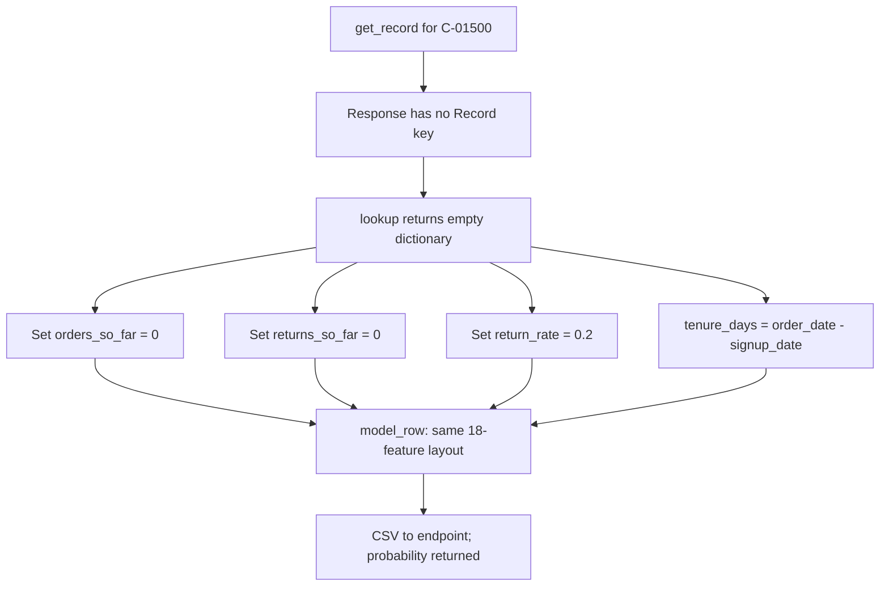

# AWS SageMaker Feature Store — Part 2: From Customer Features to Live Predictions

## Objective

This session connects the **trained return-prediction model** from Part 1 to **low-latency, per-customer features**. Instead of building a training dataset from historic orders, it prepares two live-serving resources and brings them together to score an individual order at checkout.

The key progression is:

**Part 1 model artifact → S3 → SageMaker model → endpoint configuration → real-time endpoint**

**Part 1 customer-feature history → `rows` → Feature Store group with online store → latest customer record**

**Checkout order + `get_record(customer_id)` → `model_row` (18 ordered numbers) → `invoke_endpoint` → return probability.**

**Scenario:** An online retailer wants to estimate whether a customer will return an order **while the order is being placed**. Part 1 used 12,000 synthetic orders from 1,440 customers to create 15,598 time-stamped customer-feature rows and train an XGBoost model on **18 ordered numerical inputs**. Part 2 uses that trained model and those existing feature rows. It does **not** retrain XGBoost or recompute those rows from raw orders.

**Opening question:** “At checkout, do we need to query every past transaction with Athena, or do we just need the latest known feature record for this customer—and where does the trained model actually live?”

**Operating rule:** Initial resource setup is done through the **AWS console / SageMaker Studio**; the substantive code runs in a **SageMaker JupyterLab Python kernel**. The notebook contains code-formatted reference snippets and saved illustrative output—do **not** indiscriminately execute every code cell with *Run All*. Example response times, probabilities and AWS resource IDs are from the saved run, not promised results.

## One-page project flow

This flow shows **two setup branches** that meet when an order arrives. The endpoint branch is started early because provisioning takes time. Creating the feature group and ingesting records happen while the endpoint is starting.

**What connects everything:** The notebook kernel downloads the model, uploads it to **S3** and issues **SageMaker control-plane** calls to launch an endpoint. Separately, it loads `rows` into **pandas**, creates a feature group and sends timestamped records using the **Feature Store Runtime**. The **online store** supplies current customer features; the **real-time endpoint** serves the trained model. The JupyterLab client code connects them. **S3 offline history is written asynchronously but is not queried with Athena in this session.**

## The live request path — the diagram to revisit during checkout

**Three different “places” learners should never conflate:**

- **JupyterLab kernel:** computes and serializes inputs, calls AWS APIs and prints the result; it is **not** the serving model.
- **Feature Store online storage:** retrieves **one customer's latest feature record** using `get_record`; it does **not** generate return probabilities.
- **SageMaker endpoint:** hosts XGBoost and turns an **18-value CSV row** into a probability; it does **not** independently fetch customer history.

### Online and offline: same feature group, different purposes

| Question | Online store | Offline store |
|---|---|---|
| What is retained? | Latest feature record per customer, ordered by `event_time` | Historical, time-stamped feature rows in S3 |
| How is it accessed here? | `get_record` by `customer_id` | Not read in this notebook |
| Typical read pattern | Single-key lookup, intended for milliseconds | Batch history/SQL via Athena (as in Part 1) |
| Which part uses it? | Live checkout scoring | Historical training and reconstruction |
| Configured in this notebook? | **Yes**: `OnlineStoreConfig={"EnableOnlineStore": True}` | **Yes**: `OfflineStoreConfig` |

**Important nuance:** The notebook writes the 15,598 historical rows again to a **newly created / recreated** feature group. That gives the online store a latest record for the example customers. It does **not** demonstrate an application automatically updating features every time a *new* order or return arrives.

## The exact data and resource handoffs

| Artifact / resource | Where it is created or obtained | Who uses it next | Meaning |
|---|---|---|---|
| `model.tar.gz` (source) | Downloaded from the course's public GitHub repository | JupyterLab upload | Copy of the pretrained honest XGBoost model from the earlier project |
| `s3://<BUCKET>/fs-model/model.tar.gz` | `s3.upload_file` | SageMaker `create_model` | Durable model artifact URI |
| `returns-fs-model` | SageMaker `create_model` | Endpoint configuration | Model resource: XGBoost container image + S3 model URI + execution role |
| `returns-fs-config` | SageMaker `create_endpoint_config` | Endpoint | Serving variant and `ml.m5.large` instance definition |
| `returns-fs-rt` | SageMaker `create_endpoint` | `invoke_endpoint` | Live inference endpoint, once `InService` |
| `customer_features.csv` | Course-hosted feature table from Part 1 | `pd.read_csv` | Already-derived historical customer-feature events |
| `rows` (pandas DataFrame) | JupyterLab | `put_record` | 15,598 rows for 1,440 customers, six columns each |
| `returns-customers` feature group | `sm.create_feature_group` | Feature Store Runtime | Schema, `customer_id` record key, `event_time`, online + offline config |
| Online feature records | Feature Store Runtime `put_record` | `get_record` | Latest known features for a requested customer |
| S3 `feature-store/` data | Asynchronous offline materialization | Potential future Athena queries | Historical record archive; **not read here** |
| `answer` | `store.get_record` | `lookup` / inspection | Returned feature pairs as strings, or no `Record` for an unseen customer |
| `order` (Python dictionary) | Example checkout cell | `model_row` | Current order properties, customer id, order date |
| 18-element model row | `model_row(order, features)` | `predict` | Five order inputs + four customer inputs + nine one-hot flags |
| CSV request string | `predict` | SageMaker Runtime `invoke_endpoint` | Comma-separated 18 numbers with `ContentType="text/csv"` |
| Return probability | Endpoint response body | `predict` / caller | One numeric estimate for the order |

**Storage clarity:** A **SageMaker model resource** is metadata pointing to a model archive and container; the archive lives in **S3**. An **endpoint configuration** describes serving compute; the **endpoint** runs that compute. The **feature group** defines where feature data is managed; its **online** and **offline** stores are different retrieval surfaces. The notebook's `rows` and `order` dictionaries exist in JupyterLab memory, not inside the endpoint.

## The 18-value contract between training and serving

The critical bridge to Part 1 is that the live model must receive **exactly the same 18 input features, in exactly the same order**, as `model_table` used to create the training CSV. The label column `returned` from Part 1 is **not** sent at inference time.

| CSV positions (1-indexed) | Source | Exact feature order | Count |
|---|---|---|---:|
| 1–5 | Current order | `price`, `discount_pct`, `delivery_days`, `is_gift`, `seller_rating` | 5 |
| 6–9 | Online customer record | `orders_so_far`, `returns_so_far`, `return_rate`, `tenure_days` | 4 |
| 10–14 | Category one-hot flags | `apparel`, `beauty`, `books`, `electronics`, `home` | 5 |
| 15–18 | Payment one-hot flags | `card`, `cod`, `upi`, `wallet` | 4 |
| **Total** | | | **18** |

**Saved example:** an order on **1 October 2026** for a book priced **450**, with **5% discount**, `delivery_days=3`, `is_gift=0`, `seller_rating=4.4`, paid by **card**.

| Input | C-00001 | C-00002 | C-01500 (unseen) |
|---|---:|---:|---:|
| `orders_so_far` | 14 | 5 | 0 |
| `returns_so_far` | 11 | 1 | 0 |
| `return_rate` | 0.6316 | 0.2 | 0.2 |
| `tenure_days` | 1126 | 1096 | 11 (derived from signup date) |
| Example model probability | **0.653** | **0.045** | **0.151** |

The order properties and one-hot flags are identical in the initial comparison. **Only the four customer features change.** These probability values are outputs from the saved notebook execution, not guaranteed or necessarily calibrated results for live business decisions.

### Unseen-customer branch: why it cannot just be all zeroes

The rate of **0.2** matches Part 1's smoothing/default behavior; it is not the empirical return rate of an unseen customer. For the notebook's unseen customer, the signup date is **20 September 2026**, making tenure **11 days** on **1 October 2026**. **The caller must supply `signup_date`** if no online feature record exists.

## Detailed section list — in notebook order

### 0. Preface — From historical training to real-time serving

**Notebook:** Preface and agenda.

- Recap: Part 1 used offline history, a point-in-time join and an XGBoost training job (saved validation AUC approximately **0.72**).
- Part 2 uses a trained model without repeating training and retrieves a customer's newest features without querying their whole history.
- Two components must be ready: **online Feature Store** and **inference endpoint**.
- **Checkpoint:** Which part answers “what is currently known about this customer?” and which answers “how likely is this order to be returned?”

### 1. Why an online store

**Notebook:** §1.

- Offline S3 + Athena supports SQL over many historical rows, which suited Part 1's model construction.
- Checkout needs a **keyed lookup**, not a full-history analytical query.
- With `EnableOnlineStore=True`, Feature Store maintains the **most recent event-time record per identifier**, while also writing historical rows to the configured offline store.
- **Checkpoint:** If records arrive out of chronological order, why should the latest `event_time`, rather than the final API call, determine the live value?

### 2. Prepare the AWS workspace

**Notebook:** §2.

1. **AWS console:** Check the default VPC; use the same region as the code: **`us-west-2` (US West / Oregon)**.
2. **SageMaker Studio:** Create or reuse a Quick setup domain; open JupyterLab space **`features`**.
3. **JupyterLab:** Upload and open the notebook using the Python 3 kernel.
4. **Python setup cell:** Set `REGION`, `FEATURE_GROUP`, `ENDPOINT`, `ACCOUNT`, `BUCKET`, `ROLE`; initialize three clients:
   - `sm = boto3.client("sagemaker")` — creates/describes managed resources.
   - `store = boto3.client("sagemaker-featurestore-runtime")` — reads/writes feature records.
   - `s3 = boto3.client("s3")` — transfers S3 objects.

**Resource names in the notebook:**

- `FEATURE_GROUP = "returns-customers"`
- `ENDPOINT = "returns-fs-rt"`
- `BUCKET = f"sagemaker-{REGION}-{ACCOUNT}"`
- `ROLE = get_execution_role()`

**Checkpoint:** Does a Python cell execute in the local browser, the JupyterLab space, or the endpoint? Which identity authorizes its calls?

### 3. Start the endpoint early — model-serving branch

**Notebook:** §3.

1. `urllib.request.urlretrieve` downloads a pretrained **`model.tar.gz`** from `pulkit-scaler/mlops-feature-store-2` on GitHub into the JupyterLab environment.
2. `s3.upload_file` copies it to **`s3://<BUCKET>/fs-model/model.tar.gz`**.
3. `sm.create_model` registers **`returns-fs-model`** pointing to that S3 model and the regional **XGBoost `1.7-1`** container image.
4. `sm.create_endpoint_config` creates **`returns-fs-config`**, one `ml.m5.large` instance, initial count one.
5. `sm.create_endpoint` requests **`returns-fs-rt`**, initially `Creating`.
6. Return to feature-store work while serving resources provision. §6 explicitly waits for `InService`.

**Saved example:** endpoint reached `InService` in roughly **200 seconds**. This is a demonstration, not a provisioning-time guarantee.

**Important handoff:** `create_model` does **not** train XGBoost. It points at the archived model produced elsewhere. `create_endpoint` launches separate managed serving compute; JupyterLab only initiates the resource creation.

**Checkpoint:** What would break if the S3 `model.tar.gz` object existed but the SageMaker endpoint had never been created?

### 4. Recreate and populate the feature group — data-serving branch

**Notebook:** §§4.1–4.3.

**4.1 — Load the existing rows.** `pd.read_csv(FEATURES_URL)` reads precomputed **`customer_features.csv`** into `rows`: saved run **15,598 rows / 1,440 customers**. This is a saved output of Part 1's feature engineering, not a fresh computation from `returns_events.csv`.

**4.2 — Define the group with both stores.** `sm.create_feature_group` defines six typed columns:

- `customer_id` (`String`) — record identifier.
- `event_time` (`String`) — event time used to identify the newest record.
- `orders_so_far`, `returns_so_far`, `tenure_days` (`Integral`); `return_rate` (`Fractional`).

It sets `OnlineStoreConfig={"EnableOnlineStore": True}` **and** `OfflineStoreConfig` with an S3 destination under `feature-store/`. The code polls until the group leaves `Creating`, and Studio's Feature Store details show **Online/Offline**.

**4.3 — Ingest records.** `store.put_record(...)` sends each row as name/value strings. The initial write is retried while the newly created group becomes available; then `ThreadPoolExecutor(max_workers=8)` sends the rows concurrently. Saved example: **15,598 looped rows in about 25 seconds**.

- **Online path:** the current feature row for each customer is available for key lookup.
- **Offline path:** the historical records are materialized to S3 **asynchronously**; this class does not wait for Athena visibility.

**Checkpoint:** Does the endpoint deployment populate the online feature store? (No—they are independent branches.)

### 5. Read the newest features for one customer

**Notebook:** §5.

- Invoke `store.get_record(FeatureGroupName=FEATURE_GROUP, RecordIdentifierValueAsString="C-00001")` five times.
- Saved example: **22 ms**, then **8–9 ms** per call. These are measured API round trips in the saved run; production latency requires separate testing.
- The returned record's feature values are **strings**, even when semantically numeric.
- Example for C-00001: newest `event_time` **14 September 2026**, `orders_so_far=14`, `returns_so_far=11`, `return_rate=0.6316`, `tenure_days=1126`.
- Even though 25 feature rows exist for this sample customer, the online lookup returns **one** current record.

**Checkpoint:** Why is `float(features["return_rate"])` needed before model inference?

### 6. Put an order through the live path

**Notebook:** §§6.1–6.3.

**6.1 — Confirm endpoint readiness.** Use `sm.get_waiter("endpoint_in_service")` and `sm.describe_endpoint` to confirm **`returns-fs-rt`** is ready.

**6.2 — Define three client-side functions.**

1. `lookup(customer_id)`: calls **Feature Store Runtime `get_record`**, returning a name/value dictionary, or `{}` if no `Record` exists.
2. `model_row(order, features)`: concatenates exactly **five order values + four historical customer values + five category one-hot flags + four payment flags**. For unseen customers, fills history with the Part 1 defaults and calculates tenure from order and signup dates.
3. `predict(order)`: serializes the 18 values as one comma-separated row; uses **SageMaker Runtime `invoke_endpoint`**, `ContentType="text/csv"`; converts the response body to a float. This adds a *fourth* boto3 client: `boto3.client("sagemaker-runtime")`.

**6.3 — Same order, different customers.** Score the same book order for **C-00001** and **C-00002**. Saved results: **0.653** and **0.045**, with **183 ms** then **45 ms** for the combined lookup and inference call. The only changed model inputs are positions **6–9**, the customer history values.

**Checkpoint:** Could the endpoint silently return a number if you swapped `return_rate` and `tenure_days`? (Yes—CSV is positional, and the prediction would be semantically wrong.)

### 7. Handle an unseen customer

**Notebook:** §7 and checkpoint 7.1.

- For customer **`C-01500`**, `get_record` returns no `Record` field; this is a legitimate missing-record case.
- `lookup` returns `{}`, and `model_row` applies training-consistent values: **0 orders, 0 returns, 0.2 rate, 11 days of tenure** (given signup date **20 September 2026**, order date **1 October 2026**).
- Saved example prediction: **0.151** for the same book order.
- The checkpoint changes the order to `category="apparel"` and `payment_method="cod"` and scores all three customers to separate **order-feature effects** from **customer-history effects**.

**Checkpoint:** Why would replacing a missing record with nine arbitrary zeroes, or setting the smoothed rate to zero, create training-serving inconsistency?

### 8. Tear down and avoid ongoing charges

**Notebook:** §8.

1. Delete **endpoint** (`returns-fs-rt`) first; serving instances accrue charges while running.
2. Delete **endpoint configuration** (`returns-fs-config`) and **model resource** (`returns-fs-model`).
3. Delete **feature group** (`returns-customers`) and its online data.
4. Delete objects under S3 prefixes **`feature-store/`** and **`fs-model/`**.
5. Stop the JupyterLab space **`features`** in Studio and verify the endpoint has gone from the console.

**Saved-run caveat:** The first cleanup deleted only one marker object under `feature-store/`, because the asynchronously materialized offline records had not yet appeared. The notebook explicitly directs rerunning cleanup approximately **ten minutes later**. Removing the feature group is **not** proof that pending offline exports have stopped or all data has been deleted.

**Warning:** The cleanup deletes **all objects under two S3 prefixes**, not only keys tagged with this particular notebook run. Confirm those prefixes contain no unrelated files. The script attempts deletion of endpoint config and model immediately after endpoint deletion; AWS deletion may still be in progress, so verify final resource states rather than assuming print statements mean everything is fully gone.

### 9. Summary; 10. References

**Notebook:** §§9–10.

- The online store supplies the **latest known customer state**, keyed by `customer_id`.
- The serving endpoint houses the **trained XGBoost model**.
- JupyterLab implements the **glue code** that queries features, builds the 18 numeric inputs, invokes the endpoint and reads its response.
- Correctness requires a **shared training/serving feature schema**, plus a well-defined fallback for unseen customers.
- This session demonstrates **live inference calls from a notebook**, not a deployed checkout website or continuous production data pipeline.

## “Where am I?” — execution and storage map

| Notebook stage | Where work executes / what is called | What is produced or read |
|---|---|---|
| §2 AWS setup | Console and SageMaker Studio browser | Domain, execution role, JupyterLab space |
| §2 Python setup | **JupyterLab kernel** | Config values and `sm`, `store`, `s3` clients |
| §3 model download/upload | JupyterLab + public GitHub + S3 | Local `model.tar.gz`, then `fs-model/model.tar.gz` |
| §3 deployment | JupyterLab calls SageMaker **control plane**; AWS provisions hosting | Model, endpoint config, endpoint entering `Creating` |
| §4.1 input features | **JupyterLab kernel** | Pandas `rows` from `customer_features.csv` |
| §4.2 schema and stores | JupyterLab calls SageMaker **control plane** | Feature group with online and offline storage |
| §4.3 ingestion | JupyterLab calls **Feature Store Runtime** | Submitted per-customer feature records |
| §4.3 asynchronous side effect | Managed Feature Store → S3 | Historical offline files (not queried this session) |
| §5 feature read | JupyterLab calls **Feature Store Runtime** | One customer record from online storage |
| §6.1 endpoint wait | JupyterLab asks SageMaker control plane | Confirms endpoint `InService` |
| §6.2 input construction | **JupyterLab kernel** | Python dictionary → ordered list → CSV string |
| §6.2 inference | JupyterLab calls **SageMaker Runtime** → serving instance | Probability returned by model |
| §7 missing record | Feature Store response + JupyterLab fallback | Training-consistent unseen-customer feature values |
| §8 cleanup | JupyterLab API calls + Studio UI | Resources deleted / space stopped (verify) |

**A four-question navigation habit** for each stage:

1. **Which compute is doing the work?** JupyterLab kernel, managed SageMaker endpoint instance, or AWS storage service?
2. **Where does this value live?** Pandas DataFrame, S3 file, online feature record, endpoint response, or merely resource metadata?
3. **What crosses the boundary?** `put_record` payload, record ID lookup, 18-value CSV, model artifact URI, or inference result?
4. **Which time does the value represent?** Feature `event_time`, current order date, ingestion time, or endpoint invocation time?

## Suggested pacing and stopping points

| Phase | Notebook sections | Suggested discussion / demonstration time* |
|---|---|---|
| Motivation + online/offline contrast | Preface, §1 | 10–15 min |
| Prepare Studio/JupyterLab and start endpoint | §§2–3 | 15–20 min, plus parallel provisioning |
| Load feature rows, configure group, ingest | §4 | 20–30 min |
| Read and inspect one customer | §5 | 10–15 min |
| Build the 18-value live inference path | §6 | 25–35 min |
| Missing record and exercise | §7 | 15–20 min |
| Teardown, verify, summarize | §§8–10 | 10–15 min, plus asynchronous cleanup check |

*Instructional estimates, not AWS timing guarantees. One natural pause is **after §5**: both serving resources are established, and the remaining sections combine them into predictions.*

## Scope boundary — what the notebook actually establishes

**Implemented:** Studio/JupyterLab setup; downloading and uploading a previously trained model; registering a SageMaker model and provisioning a real-time endpoint; creating a feature group with both online and offline stores; replaying precomputed customer-history feature records; one-customer online lookup with measured timings; constructing the same ordered 18-feature vector as training; `invoke_endpoint` scoring; handling no-history customers; exercise and teardown.

**Not implemented:** New model training; a new offline point-in-time join; Athena queries; background ingestion of new transactions and return outcomes; a hosted e-commerce application or public API; automatic feature refreshing; feature drift checks; model/version deployment automation; production security/rate limits; monitoring/alerting; load or concurrency testing; validated probability calibration; business-policy enforcement at checkout.

## Notebook consistency and teaching checks

These observations follow the supplied notebook; they **do not silently change its code**.

1. **The model is sourced from GitHub, not from this notebook's training job.** The notebook downloads a stored `model.tar.gz` from `pulkit-scaler/mlops-feature-store-2`; it does not use the earlier job's original S3 URI. When explaining continuity with Part 1, describe it as a **copy** of the pretrained model, not a live link to that old job.
2. **Data is also reloaded from a saved CSV.** `customer_features.csv` is precomputed from Part 1; §4 does not rerun `customer_features(orders)`. The online store in this project is populated from that snapshot.
3. **Two independent AWS runtimes matter.** `sagemaker-featurestore-runtime` supports `put_record`/`get_record`; `sagemaker-runtime` supports `invoke_endpoint`. `sagemaker` controls resources. They are not interchangeable.
4. **The notebook does not prove ongoing freshness.** The most recent C-00001 feature row is dated **14 September 2026**, while the sample checkout occurs on **1 October 2026**. It shows a low-latency lookup of the newest *loaded* record, not automatic real-time updates after every order or return.
5. **The feature row is written twice for its first record.** The ingestion code sends `rows.iloc[0]` as a readiness test and then includes that same row in `rows.to_dict("records")`. This does not affect the intended online latest-record demonstration, but do not claim there are exactly 15,598 unique write API calls or that offline physical history is deduplicated by this code.
6. **Feature group reuse is not checked for configuration parity.** If `returns-customers` already exists, `ResourceInUse` is caught; the code does not verify that the pre-existing resource has the online store enabled and matches the expected schema. Avoid reusing an inconsistent group.
7. **Unknown and partially missing features are different cases.** `lookup` gracefully handles *no* `Record` via `answer.get("Record", [])`, but `model_row` requires all four named history features when a nonempty dictionary exists. It does not implement validation/recovery for partially missing feature values.
8. **`tenure_days` can be stale for existing customers.** In §6, `model_row` uses the tenure stored with the customer's latest feature event. It recomputes tenure from `signup_date` only for unseen customers; an event from weeks earlier can understate tenure on checkout day. This mirrors the stored representation rather than guaranteeing as-of-now freshness.
9. **`delivery_days` still needs semantic verification.** The endpoint takes this input at checkout; if it means *actual delivery duration*, it would be unavailable then and leak future information. It is defensible only if it means a checkout-time known or estimated delivery duration. The notebook does not resolve this distinction.
10. **CSV ordering is part of the model interface.** The endpoint receives no feature names; the categories and payment encodings must match training exactly. A different order or changed category vocabulary may return a numeric but incorrect prediction.
11. **Saved latencies are not throughput guarantees.** The five `get_record` timings (**22, 8, 8, 9, 8 ms**) and two end-to-end examples (**183, 45 ms**) are sample observations. They do not establish production P95/P99 performance, cold starts, consistency or concurrency capacity.
12. **The short teardown has a long tail.** Asynchronous offline data can arrive after feature group deletion. The notebook advises repeating cleanup later; verify S3 and SageMaker states. Deleting whole prefixes can affect unrelated projects in a shared bucket.
13. **Reference code cells should not all be run.** Several code-formatted cells contain a feature-group name, region, URL, ID, or raw CSV rows for copy/reference purposes. Follow the notebook's explicitly indicated Python execution cells.
14. **No business action is implemented.** The notebook mentions examples of acting differently for high-return-risk customers, but it only returns probabilities; it does not enforce payment restrictions or other decisions.

## The one sentence to keep repeating

**Feature Store answers “What is currently known about this customer?”, the real-time endpoint answers “What does the trained model predict?”, and the notebook's 18-feature assembly is the contract that makes those two answers compatible.**
